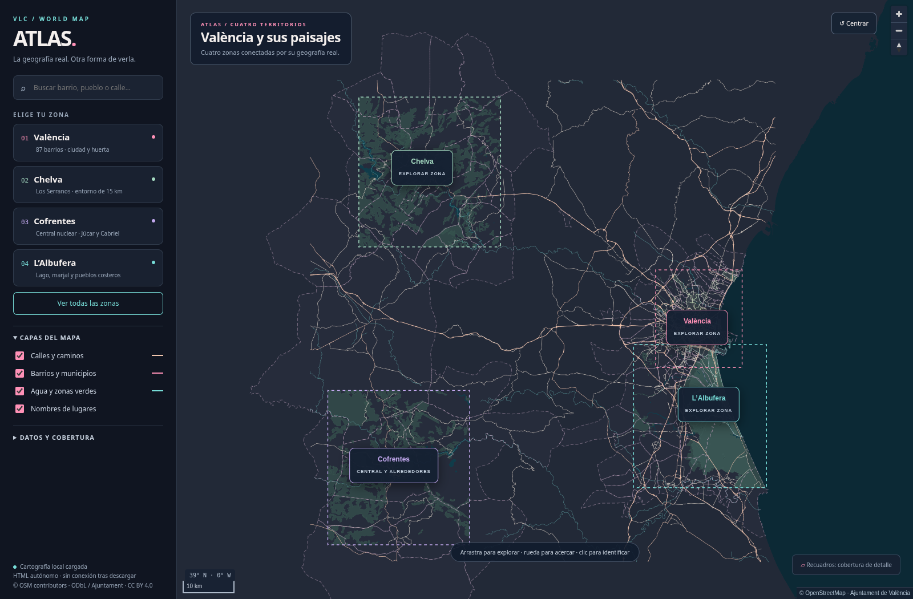
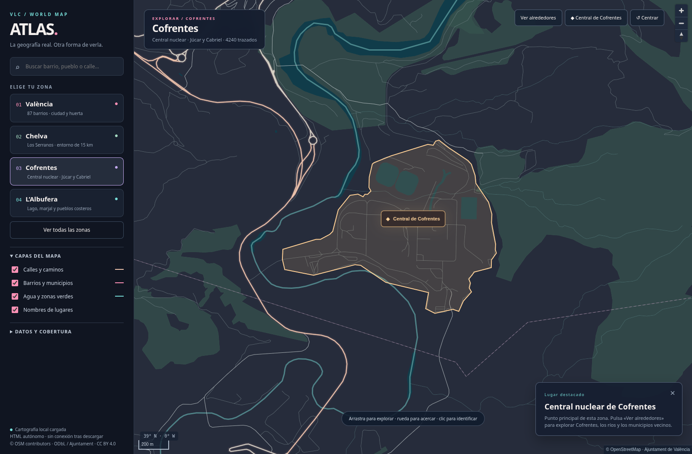

# Inhouse-Game-Engine

Atlas interactivo con cartografía real de OpenStreetMap y una estética inspirada en GTA VI.

## Isla compactada · versión V02

**[Ver captura actual](isla-v2/previews/revision-costa-chelva-cauce.png)** · **[Descargar isla interactiva en ZIP](https://github.com/miguelcoxcaballero/Inhouse-Game-Engine/raw/refs/heads/main/isla-levante-v2.zip)** · [Memoria y auditoría](isla-v2/PROPUESTA-Y-AUDITORIA.md)

Una isla ficticia de **49 km²**, con València, Alboraia, Port Saplaya, aeropuerto, Bonaire, Chelva, Benagéber, Cofrentes y su central, Albufera, Safor, Calpe e Ifac. Incluye playas, puerto, antiguo F1, universidades, metro/tranvía compacto y dos líneas de Cercanías inventadas.

València conserva 440 manzanas seleccionadas y ocupa 6,75km² de envolvente urbana, un 24,9 % más que el borrador anterior. La transición sur añade Mercavalència, Sedaví, Alfafar, Catarroja, Castellar y Pinedo, con huerta y marjal. El aeropuerto tiene pista de 2,20 km, terminales y rodajes OSM sobre una llanura, con accesos V-11/N-220 y A-3. Chelva queda en el interior, junto a Benagéber y 20 tramos secundarios/de montaña (31,7 km). Todas las playas se apoyan en la costa.

La última revisión reemplaza los recortes de autovía por corredores OSM continuos y añade el nuevo cauce del Turia con la V-30. La UI propia incorpora herramientas flotantes, filtros, agrupación, medición y dibujo. Se conservan las curvas y los cruces como referencia, con menos manzanas; todavía requiere revisión fina de intersecciones y rasantes. [Comparación de vías rápidas](isla-v2/previews/vias-osm-comparacion.png).

El último ajuste acerca València 300 m a la costa y el centro del nuevo cauce hasta 450 m a la ciudad. Chelva baja 200 m y queda más al interior, con acceso directo por un corredor CV-35 de 1,51 km de diseño y un viaducto sobre un brazo de Benagéber.

[HTML autónomo](isla-v2/isla-levante-v2.html) · [Archivos y reproducción](isla-v2/README.md). GitHub muestra el HTML como código: descarga el ZIP y abre el HTML para usarlo. Los mapas reales anteriores siguen disponibles debajo.

## Descargar y abrir

**[Descargar los dos mapas en ZIP](https://github.com/miguelcoxcaballero/Inhouse-Game-Engine/raw/refs/heads/main/mapas-interactivos.zip)**

Descomprime el ZIP y abre uno de los HTML en Chrome, Edge o Firefox actualizado. Los mapas incluyen los datos y la biblioteca de visualización, por lo que funcionan sin conexión y no requieren instalación ni servidor.

| Archivo | Contenido |
| --- | --- |
| [valencia-interactivo.html](valencia-interactivo.html) | València con sus 87 barrios oficiales. |
| [atlas-valencia-chelva-cofrentes-albufera.html](atlas-valencia-chelva-cofrentes-albufera.html) | Atlas conjunto de València, Chelva, Cofrentes y l’Albufera, con sus alrededores. |
| [LEEME.txt](LEEME.txt) | Controles, cobertura y fuentes de datos. |
| [fuentes.json](fuentes.json) | Procedencia, fecha de los datos y áreas de cobertura. |

GitHub muestra los archivos HTML como código; para usar los mapas, descarga el ZIP o el archivo mediante **Download raw file** y ábrelo en el navegador.

## Explorar

- Desplazamiento y zoom, búsqueda de lugares y calles, e identificación mediante clic.
- Selector de zonas y controles para calles, límites, agua, zonas verdes y nombres.
- València dividida en 87 barrios oficiales; las otras zonas muestran límites municipales de OSM.
- Cofrentes se abre centrado en la central nuclear, con marcador destacado y un botón para ver los alrededores.
- Interfaz adaptable a escritorio y móvil.

## Datos y atribución

- © [OpenStreetMap contributors](https://www.openstreetmap.org/copyright), licencia ODbL. Extracto de [Geofabrik](https://download.geofabrik.de/europe/spain/valencia.html) del 25 de octubre de 2026.
- Barrios: [Ajuntament de València](https://opendata.vlci.valencia.es/dataset/barris-barrios), CC BY 4.0. Las 88 geometrías originales se agrupan en 87 códigos de barrio.
- Visualización: MapLibre GL JS 5.6.2, BSD-3-Clause.

Los recuadros indican las áreas de detalle descargadas, no límites administrativos. Entre zonas se conservan carreteras principales. Cartografía general para exploración; no incluye rutas, tráfico en directo ni un modelo 3D.

## Validación

Comprobados el cambio entre las cuatro zonas, la búsqueda, las capas, el enfoque de Cofrentes y la vista móvil. La prueba del navegador no registró errores ni solicitudes a servicios externos de mapas.
