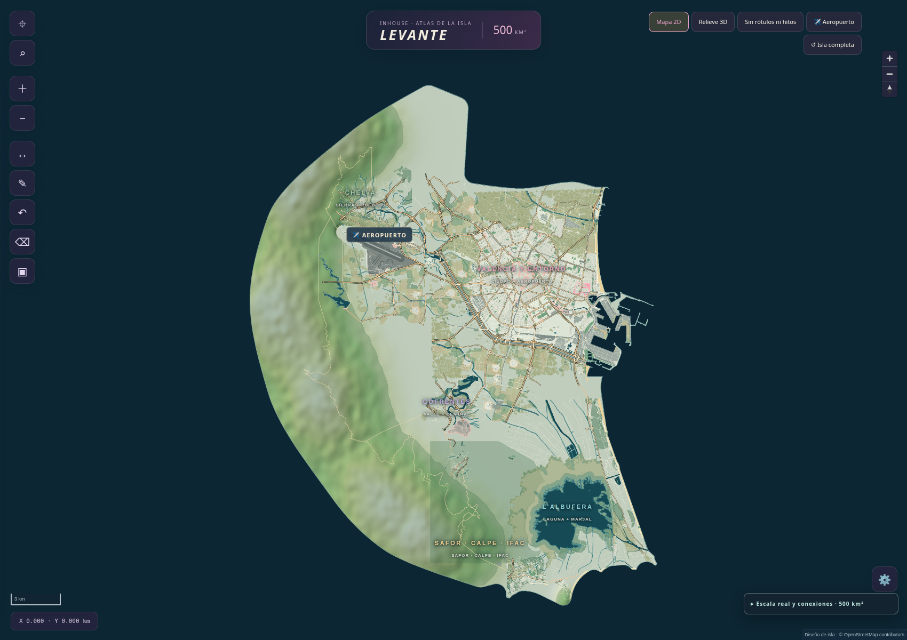
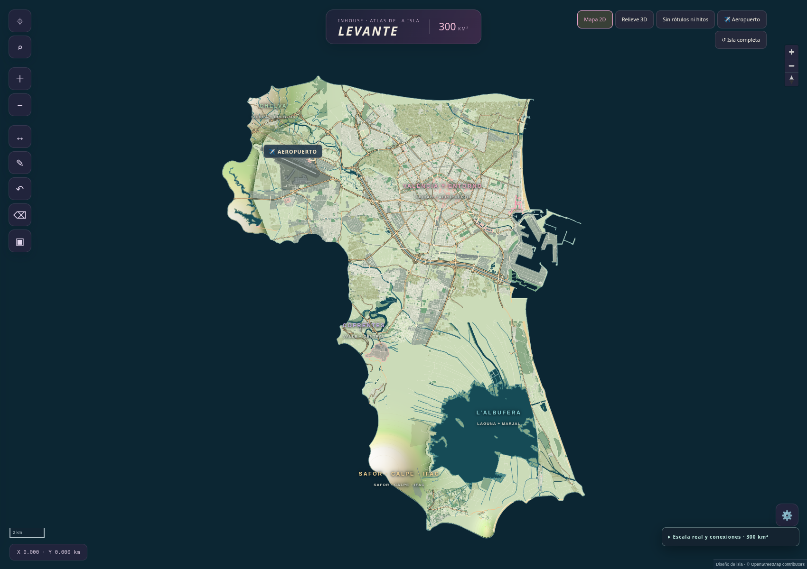

# Inhouse-Game-Engine

Atlas interactivo con cartografía real de OpenStreetMap y una estética inspirada en GTA VI.

## Descargar versión jugable

**[Descargar Forja para Windows (última versión)](https://github.com/miguelcoxcaballero/Inhouse-Game-Engine/releases/latest/download/Forja-Windows.zip)** · [Todas las versiones](https://github.com/miguelcoxcaballero/Inhouse-Game-Engine/releases)

Juego en mundo abierto con el motor Forja: ciudad procedural de Madrid y Valencia, personajes, coches, armas e inventario. Requiere Windows 10/11 de 64 bits y una GPU con DirectX 12.

**Novedades de la v0.1.2:** nuevo mapa por defecto con cascos antiguos orgánicos (Madrid de los Austrias en una colina y el Barrio del Carmen) —callejones irregulares en cuesta, calles de escaleras, plazas— cruzados por grandes avenidas, junto a una cuadrícula madrileña, un Ensanche valenciano y un bulevar; tráfico con IA, peatones, mobiliario urbano valenciano y árboles procedurales; cámara diurna física y noche real (F3). Presupuestado para una GTX 1660 / RX 580 a 1080p en Alto (~2,3 GB de VRAM, ~3 GB de RAM). **F9** abre las opciones gráficas con presets Bajo/Medio/Alto/Ultra (Auto según la GPU) y **F11** el perfilador (FPS, tiempos CPU/GPU, VRAM).

1. Descomprime `Forja-Windows.zip` en cualquier carpeta.
2. Abre `Jugar.bat`. La primera vez descarga el contenido libre (unos 0,8-1 GB, con progreso en la consola); después arranca directamente.

Controles: WASD mover · ratón mirar · Shift correr · Espacio saltar/freno de mano · F subir/bajar del coche · clic derecho apuntar · clic izquierdo disparar · R recargar · 1-6 armas · Tab inventario · V cámara · F3 hora del día · F9 gráficos · F11 perfilador · F10 ayuda · Esc soltar ratón/salir. Detalles en `LEEME.txt` dentro del ZIP. Cada etiqueta `v*` compila el ZIP con [GitHub Actions](.github/workflows/release.yml).

## Isla de 500 km² · editor actual

**[Descargar el editor de 500 km²](https://github.com/miguelcoxcaballero/Inhouse-Game-Engine/raw/refs/heads/main/levante-editor-500km2.zip)** · [HTML](isla-v5/isla-levante-editor-500.html) · [Isla completa](isla-v5/previews/isla-500.png) · [Sur de Valencia](isla-v5/previews/sur-valencia-500.png) · [Datos e instrucciones](isla-v5/README.md).

200 km² adicionales hacia el interior y 25.499 huellas suburbanas eliminadas para dar espacio a campo y montaña. La Albufera reduce su superficie a la mitad, de 24,31 a 12,15 km². Se recorta también la zona comercial e industrial de Alfafar donde está IKEA. Valencia, Alboraia y Port Saplaya conservan sus edificios a tamaño real; el aeropuerto mantiene la pista completa y Bonaire permanece.

La isla contiene 43.738 edificios, 100 elementos arquitectónicos protegidos y unos 76 km de nuevas carreteras secundarias por las sierras. Los 18 destinos principales tienen recorridos comprobados. El editor permite dibujar calles, mover edificios en grupo y exportar las sugerencias. [Auditoría](isla-v5/data/audit.json) · [Recorte suburbano](isla-v5/data/rural-revision.json). El relieve y los enlaces entre zonas son de diseño; la navegación con sentidos únicos y cotas sigue pendiente.

## Isla de 300 km² · versión anterior

**[Descargar el editor de 300 km²](https://github.com/miguelcoxcaballero/Inhouse-Game-Engine/raw/refs/heads/main/levante-editor-300km2.zip)** · [HTML](isla-v4/isla-levante-editor-300.html) · [Captura de Valencia](isla-v4/previews/valencia-300.png) · [Isla completa](isla-v4/previews/isla-300.png) · [Datos, instrucciones y límites](isla-v4/README.md).

Valencia conserva su geometría OSM a escala real: 49.859 huellas urbanas, calles, avenidas y posiciones relativas. La isla reúne 69.237 edificios. El aeropuerto se acerca 750 m conservando su pista completa de 2,92 km; la Albufera y sus pueblos se trasladan juntos 1,5 km hacia el norte. Los núcleos exteriores conservan sus edificios y calles locales a tamaño real. El editor permite dibujar calles, mover edificios en grupo y exportar sugerencias.

Las conexiones se comprueban usando vértices compartidos de las calles, sin convertir automáticamente los cruces entre puentes en intersecciones. [Auditoría](isla-v4/data/audit.json) · [Recorridos](isla-v4/data/integration-review.json). El relieve es de diseño y el trazado histórico del F1 sigue pendiente de reconstrucción exacta.

## Isla de 100 km² · versión anterior

**[Descargar el editor de 100 km²](https://github.com/miguelcoxcaballero/Inhouse-Game-Engine/raw/refs/heads/main/levante-editor-100km2.zip)** · [HTML](isla-v3/isla-levante-editor-100.html) · [Captura de Valencia](isla-v3/previews/valencia-100.png) · [Datos, instrucciones y límites](isla-v3/README.md).

930 manzanas completas eliminadas y su espacio cerrado; 14.597 huellas urbanas conservadas a tamaño real y 100 elementos arquitectónicos protegidos. Blasco Ibáñez y el Cid se acortan conservando sus direcciones y giros principales. La isla mide 100 km² e incluye el Jardín del Turia como parque seco. El editor muestra nueve recorridos exteriores comprobados; el 99,3 % de la longitud viaria conduce al componente principal en la revisión plana. Los cruces a distinto nivel y el trazado histórico del F1 siguen en revisión. [Comparación de Blasco Ibáñez](isla-v3/previews/blasco-comparacion.png) · [Conexiones de la isla](isla-v3/previews/conexiones-isla.png).

## Editor anterior · 49 km²

[Descargar editor en ZIP](https://github.com/miguelcoxcaballero/Inhouse-Game-Engine/raw/refs/heads/main/levante-editor.zip) · [HTML del editor](isla-v2/isla-levante-editor.html) · [Instrucciones](isla-v2/EDITOR.md). Permite dibujar calles, seleccionar y arrastrar varios edificios y exportar una ficha JSON para revisar los cambios.

## Isla compactada · versión V02

**[Ver captura actual](isla-v2/previews/revision-costa-chelva-cauce.png)** · **[Descargar isla interactiva en ZIP](https://github.com/miguelcoxcaballero/Inhouse-Game-Engine/raw/refs/heads/main/isla-levante-v2.zip)** · [Memoria y auditoría](isla-v2/PROPUESTA-Y-AUDITORIA.md)

Una isla ficticia de **49 km²**, con València, Alboraia, Port Saplaya, aeropuerto, Bonaire, Chelva, Benagéber, Cofrentes y su central, Albufera, Safor, Calpe e Ifac. Incluye playas, puerto, antiguo F1, universidades, metro/tranvía compacto y dos líneas de Cercanías inventadas.

València conserva **231 manzanas completas y los 100 elementos arquitectónicos solicitados a escala 1:1 en planta**. Los anillos y avenidas principales —Cid, Blasco Ibáñez, Grandes Vías y rondas— conservan la forma y los giros de sus trazados OSM, acortando las distancias. La ciudad ocupa unos 6,38 km² de envolvente viaria. Se eliminan manzanas secundarias para dar espacio a las piezas protegidas.

El Miguelete es independiente y permanece unido espacialmente a la Catedral. [Tabla de medidas de los 100 elementos](isla-v2/ESCALA-EDIFICIOS.csv) · [Auditoría 1:1](isla-v2/data/architecture-review.json) · [Comparación de avenidas y anillos](isla-v2/previews/avenidas-anillos-comparacion.png). Las alturas sin dato OSM siguen siendo aproximaciones de vista previa.

La red viaria representada forma un único conjunto en la comprobación plana; carriles, prioridades y cruces a distinto nivel aún requieren desarrollo. Se mantienen aeropuerto y accesos, costa y paseos, nuevo cauce/V-30, Chelva interior, Benagéber, Cofrentes y central, Albufera y transición sur, Safor/Calpe/Ifac, metro y Cercanías ficticio.

[HTML autónomo](isla-v2/isla-levante-v2.html) · [Archivos y reproducción](isla-v2/README.md). GitHub muestra el HTML como código: descarga el ZIP y abre el HTML para usarlo. Los mapas reales anteriores siguen disponibles debajo.

## Descargar y abrir

**[Descargar los dos mapas en ZIP](https://github.com/miguelcoxcaballero/Inhouse-Game-Engine/raw/refs/heads/main/mapas-interactivos.zip)**

Descomprime el ZIP y abre uno de los HTML en Chrome, Edge o Firefox actualizado. Los mapas incluyen los datos y la biblioteca de visualización, por lo que funcionan sin conexión y no requieren instalación ni servidor.

| Archivo | Contenido |
| --- | --- |
| [valencia-interactivo.html](valencia-interactivo.html) | València con sus 87 barrios oficiales. |
| [atlas-valencia-chelva-cofrentes-albufera.html](atlas-valencia-chelva-cofrentes-albufera.html) | Atlas conjunto de València, Chelva, Cofrentes y l’Albufera, con sus alrededores. |
| [LEEME.txt](LEEME.txt) | Controles, cobertura y fuentes de datos. |
| [fuentes.json](fuentes.json) | Procedencia, fecha de los datos y áreas de cobertura. |

GitHub muestra los archivos HTML como código; para usar los mapas, descarga el ZIP o el archivo mediante **Download raw file** y ábrelo en el navegador.

## Explorar

- Desplazamiento y zoom, búsqueda de lugares y calles, e identificación mediante clic.
- Selector de zonas y controles para calles, límites, agua, zonas verdes y nombres.
- València dividida en 87 barrios oficiales; las otras zonas muestran límites municipales de OSM.
- Cofrentes se abre centrado en la central nuclear, con marcador destacado y un botón para ver los alrededores.
- Interfaz adaptable a escritorio y móvil.

## Datos y atribución

- © [OpenStreetMap contributors](https://www.openstreetmap.org/copyright), licencia ODbL. Extracto de [Geofabrik](https://download.geofabrik.de/europe/spain/valencia.html) del 25 de octubre de 2026.
- Barrios: [Ajuntament de València](https://opendata.vlci.valencia.es/dataset/barris-barrios), CC BY 4.0. Las 88 geometrías originales se agrupan en 87 códigos de barrio.
- Visualización: MapLibre GL JS 5.6.2, BSD-3-Clause.

Los recuadros indican las áreas de detalle descargadas, no límites administrativos. Entre zonas se conservan carreteras principales. Cartografía general para exploración; no incluye rutas, tráfico en directo ni un modelo 3D.

## Validación

Comprobados el cambio entre las cuatro zonas, la búsqueda, las capas, el enfoque de Cofrentes y la vista móvil. La prueba del navegador no registró errores ni solicitudes a servicios externos de mapas.

## Motor Forja (Rust)

La carpeta [`engine/`](engine/) contiene el motor de juego en Rust: física modular, render wgpu (DX12 en Windows) con GTAO, TAA, PCSS y SSR, animación con captura de movimiento CMU, personajes Rocketbox, ciudad procedural de Madrid y Valencia (`forja_city`) y el sistema de monumentos reales de València (`engine/data/landmarks/valencia/`: lista de los 100 edificios, huellas OSM, partes del Catastro y modelos `landmark.toml`). Los recursos descargados (texturas, HDRI, mocap, fotos) no se suben; se obtienen con `cargo run -p forja_fetch`. Ver [`engine/PLAN.md`](engine/PLAN.md).
