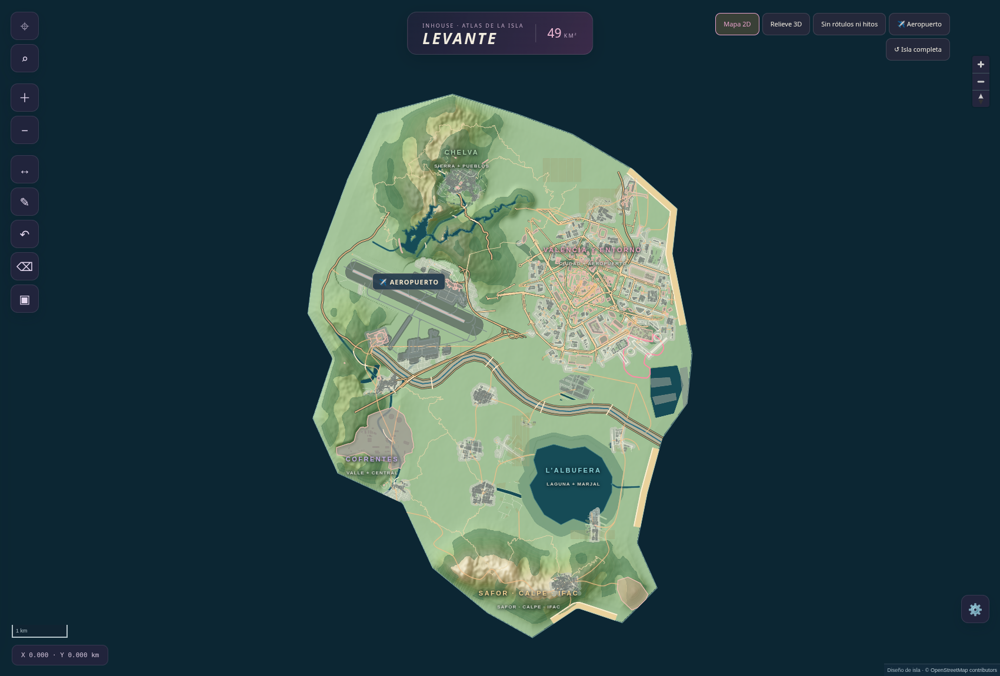

# Isla Levante · V02

**Prototipo de isla ficticia de49km², derivado de OpenStreetMap.** València y entorno, Chelva y Benagéber, Cofrentes y central, Albufera, Safor, pequeña muestra de Calpe e Ifac.

- [HTML interactivo autónomo](isla-levante-v2.html): abrir en un navegador actual. Incluye datos, relieve, librería de mapa, búsqueda,2D/3D, metro/tranvía compacto, Cercanías ficticio, cálculo de conexiones, modo sin rótulos, filtros de lugares, agrupación, medición, dibujo y ajustes guardados. No necesita descargar teselas ni llamar a APIs.
- [Paquete ZIP](../isla-levante-v2.zip): HTML, capturas, memoria y datos compactados.
- [Investigación e inventario anteriores al diseño](research/criterios-previos.md).
- [Propuesta, pérdidas, mediciones y auditoría](PROPUESTA-Y-AUDITORIA.md).
- [Comparación de vías rápidas con OSM](previews/vias-osm-comparacion.png).
- [Datos en metros locales](data/isla-metros.geojson), [red de transporte](data/transit.json), [auditoría geométrica](data/audit.json), [pruebas de navegador](data/browser-qa.json).

## Qué cambia

Valencia se recompone con **231 manzanas OSM y 100 elementos arquitectónicos a tamaño real en planta**, agrupadas y trasladadas junto con sus edificios y calles interiores. No se estiran ni se achatan; se eliminan otras manzanas y se reconstruyen las uniones por el terreno libre. La capa **Ajustes → Manzanas conservadas · escala 1:1** permite consultar la superficie original y final de cada bloque.

Las avenidas y anillos se fijan antes de colocar las piezas; Cid, Blasco Ibáñez y las rondas mantienen la geometría de sus trazados OSM acortados. [Tabla de medidas de los 100 elementos](ESCALA-EDIFICIOS.csv) y [comparación viaria](previews/avenidas-anillos-comparacion.png). Las alturas sin dato son aproximaciones explícitas de vista previa.

La revisión elimina la deformación elástica y la recolocación individual de edificios. Conserva aeropuerto, costa, puerto, universidades, pueblos, paisajes, metro y Cercanías. Los resultados exactos de conservación de geometrías y continuidad viaria están en [blocks-audit.json](data/blocks-audit.json), [network-review.json](data/network-review.json) y [la memoria actual](PROPUESTA-Y-AUDITORIA.md).

**Limitaciones concretas:** prototipo cartográfico, todavía no nivel jugable. Quedan carriles, prioridades y cruces a distinto nivel, rasantes, ajuste fino del Turia y espacios entre conjuntos, fidelidad del antiguo F1 y validación con residentes. La conectividad medida es plana; no implica que cada giro sea practicable. Metro/tranvía son servicios de juego; Cercanías es ficticio.

## Coordenadas y terreno

`isla-metros.geojson` usa un sistema local ficticio en metros; no debe interpretarse como EPSG:4326. El HTML los proyecta cerca del origen de Web Mercator únicamente para el visor. `altura-decimetros.png` contiene enteros de16bits,0,1m por unidad; extensión y tamaño en `terrain.json`. Altitudes diseñadas, no DEM real.

## Reproducir

Python3 con `osmium`, `shapely`, `pyproj`, `numpy`, `scipy`, `matplotlib` y `Pillow`. Los scripts no modifican el mapa real de OSM.

1. Obtener el extracto de Geofabrik de Comunitat Valenciana. La instantánea utilizada es2026-10-25T21:21:21Z; un extracto posterior puede cambiar resultados. Revisar `data/provenance.json`.
2. Ejecutar `python source/extract.py --pbf /ruta/valencia-region.osm.pbf` y `python source/extract_corridors.py --pbf /ruta/valencia-region.osm.pbf` y `python source/extract_benageber.py --pbf /ruta/valencia-region.osm.pbf`.
La selección inicial de bloques y las reservas espaciales se versionan en `data/block-selection-source.geojson` y `data/city-constraints.geojson`. No se recalculan leyendo la salida de la ejecución anterior.

3. Ejecutar `OPENBLAS_NUM_THREADS=1 python source/build_model.py` y después `OPENBLAS_NUM_THREADS=1 python source/enhance_model.py`.
4. Ejecutar `python source/audit.py`, `python source/revision_audit.py`, `python source/road_review.py`, `python source/blocks_audit.py`, `python source/architecture_audit.py`, `python source/plot_corridors.py`, `python source/preview.py`, `python source/build_html.py`.
5. Servir esta carpeta por HTTP local para comprobarla en navegador. `source/qa.cjs` documenta las pruebas hechas en este entorno (requiere adaptar rutas de Chromium/Playwright si se ejecuta en otro equipo).

Los datos brutos de 89 MB y el PBF de 135 MB se excluyen de Git; las selecciones compactadas sí se entregan. `source/viewer.html` es la plantilla actual; no regenerarla desde la plantilla obsoleta V1.

## Créditos

Datos ©[OpenStreetMap contributors](https://www.openstreetmap.org/copyright), licencia [ODbL1.0](https://opendatacommons.org/licenses/odbl/1-0/). La base derivada se ofrece bajo ODbL; conservar atribución y condiciones al redistribuirla. MapLibre GL JS5.6.2, BSD-3-Clause; licencia incluida en `vendor/`. Fuentes documentales enlazadas en la memoria; no se redistribuyen sus textos completos.

## UI y referencia visual

Se inspeccionó y descargó State of Leonida como referencia. No se encontró licencia para copiar íntegramente su código propio; esta entrega implementa una UI propia con organización y herramientas comparables. [Alcance, referencia y limitaciones](research/referencia-state-of-leonida.md). No se declara igualdad de detalle/realismo con ese proyecto.
